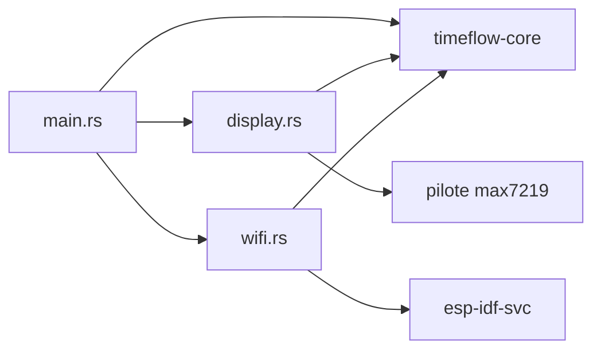

<p align="center">
  <picture>
    <source media="(prefers-color-scheme: dark)" srcset="assets/timeflow-logo-sombre.svg">
    <source media="(prefers-color-scheme: light)" srcset="assets/timeflow-logo-clair.svg">
    
  </picture>
</p>

# TimeFlow

Horloge sur bandeau LED (ESP32-WROOM-32 + MAX7219 4 modules).

Affiche l'heure `HH:MM` en chiffres 5x7, sans défilement, sur un bandeau
MAX7219 « 4 en 1 » (4 modules 8x8 = 32x8 pixels). Les deux points clignotent
chaque seconde. Heure récupérée par NTP via le Wi-Fi, avec passage automatique
heure d'été / heure d'hiver (France).

```
....#....###.......#####....#...
...##...#...#..##.....#....##...
....#.......#..##....#....#.#...
....#......#..........#..#..#...
....#.....#....##......#.#####..
....#....#.....##..#...#....#...
...###..#####.......###.....#...
```

## Câblage

Sur le connecteur d'entrée du bandeau (côté `DIN`) :

| MAX7219 | ESP32    |
|---------|----------|
| VCC     | 5V (VIN) |
| GND     | GND      |
| DIN     | GPIO23   |
| CS      | GPIO5    |
| CLK     | GPIO18   |

## Si l'affichage est tourné ou dans le désordre

Selon le modèle de bandeau, les modules sont montés différemment. Dans
`src/main.rs`, ajuster `LAYOUT` puis reflasher :

- chiffres tournés ou en miroir dans chaque module : changer `rotation`
  (`Rotation::None`, `Quarter`, `Half` ou `ThreeQuarters`) ;
- morceaux de chiffres dans le mauvais ordre : passer `reverse_modules` à `true`.

## Installation (une seule fois)

```bash
cargo install espup espflash ldproxy --locked
espup install --targets esp32
```

Puis, dans chaque nouveau terminal :

```bash
. ~/export-esp.sh
```

### Ubuntu 26.10 (ou distribution sans `libxml2.so.2`)

Le clang installé par ESP-IDF cherche `libxml2.so.2`, qui n'existe plus.
Un lien local dans le projet suffit (rien n'est modifié sur le système).
Il est déjà présent dans `.compat-libs/` ; pour le recréer :

```bash
mkdir -p .compat-libs && ln -sf /usr/lib/x86_64-linux-gnu/libxml2.so.16 .compat-libs/libxml2.so.2
```

## Configuration

Les identifiants Wi-Fi sont dans `wifi.toml` (non versionné). Pour le créer :

```bash
cp wifi.toml.example wifi.toml
```

puis y renseigner `ssid` et `password`. Ils sont intégrés au firmware à la
compilation : recompiler et reflasher après chaque modification.

Dans `src/main.rs`, on peut aussi ajuster `INTENSITY` (luminosité, de 0x00 à 0x0F)
et `STYLE` (clignotement des deux points).

Sur le réseau, l'ESP32 s'annonce sous le nom `timeflow`, réglé par `HOSTNAME`
dans `src/main.rs` et envoyé à la box dans les requêtes DHCP. Le log de
démarrage l'affiche (`Network hostname: timeflow`).

Si la box montre un autre nom (« espressif », par exemple), le firmware n'y est
pour rien : il n'envoie jamais ce nom. Deux causes possibles :

- la box a gardé le nom vu lors d'une connexion précédente (un ancien firmware
  sur la même carte, la box retenant les appareils par adresse MAC) : renommer
  ou oublier l'appareil dans son application, puis reconnecter l'horloge ;
- la box affiche le fabricant déduit de l'adresse MAC (« Espressif ») à la
  place du nom DHCP, ou en plus : seul le renommage dans son application y
  change quelque chose.

## Compiler et flasher

Brancher l'ESP32 en USB, puis :

```bash
. ~/export-esp.sh
LD_LIBRARY_PATH=$PWD/.compat-libs cargo run --release
```

Pour compiler seulement, sans flasher :

```bash
LD_LIBRARY_PATH=$PWD/.compat-libs cargo build --release
```

La première compilation télécharge ESP-IDF (plusieurs Go dans `.embuild/`)
et prend une dizaine de minutes.

## Architecture

Le projet est un workspace Cargo de deux crates :

- **`timeflow-core/`** : toute la logique qui ne touche pas au matériel. Il
  compile et se teste sur PC, sans ESP32.
- **`timeflow`** (racine) : le firmware. Il ne fait que brancher le matériel
  (bandeau, Wi-Fi, NTP) sur les abstractions de `timeflow-core`.

```
timeflow-core/src/
  time.rs     heure validée et fuseau de Paris (été / hiver)
  frame.rs    rendu de « HH:MM » en image 32x8, découpage en modules 8x8
  screen.rs   trait Screen et cache des images déjà affichées
  link.rs     décision de (re)connexion Wi-Fi (association puis DHCP)
  health.rs   journalisation des pannes sans inonder les logs
  timer.rs    minuterie périodique non bloquante
src/
  main.rs     initialisation et boucle principale (toutes les 200 ms)
  display.rs  adaptateur du pilote MAX7219 vers Screen
  wifi.rs     connexion Wi-Fi non bloquante
build.rs      injecte les identifiants de wifi.toml dans le firmware
```



À chaque tour de boucle, le firmware vérifie le Wi-Fi (et relance la connexion
si besoin), lit l'heure UTC synchronisée par NTP, la convertit en heure de
Paris, dessine l'image et l'envoie au bandeau si elle a changé. Aucun appel
n'est bloquant : l'heure reste affichée pendant une coupure du Wi-Fi.

Le code s'appuie sur quelques design patterns : Newtype (`Time`), Strategy
(`TimeZone`), Adapter (`Max7219Screen`), Decorator (`CachedScreen`) et State
(`Reconnector`). Le détail est dans [docs/architecture.md](docs/architecture.md)
et [docs/design-patterns.md](docs/design-patterns.md).

## Tests

La logique indépendante du matériel est dans le crate `timeflow-core`, testé
sur PC (pas besoin de l'ESP32) :

```bash
cargo test-core
```

## Formatage du code

Le style est défini dans `rustfmt.toml` (rustfmt est fourni avec la toolchain `esp`) :

```bash
cargo fmt          # formate le code
cargo fmt --check  # vérifie seulement, sans rien modifier
```

## Documentation

La documentation technique (architecture, design patterns) est dans [docs/](docs/README.md),
et les règles de contribution dans [CLAUDE.md](CLAUDE.md).

## Licence

Ce projet est distribué sous la licence Apache 2.0. Voir le fichier [LICENSE](LICENSE).
