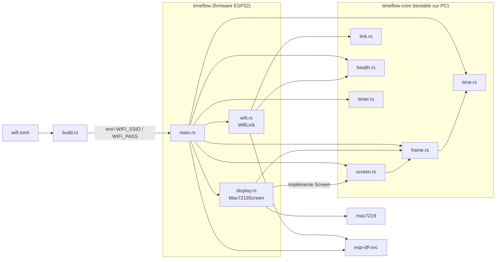
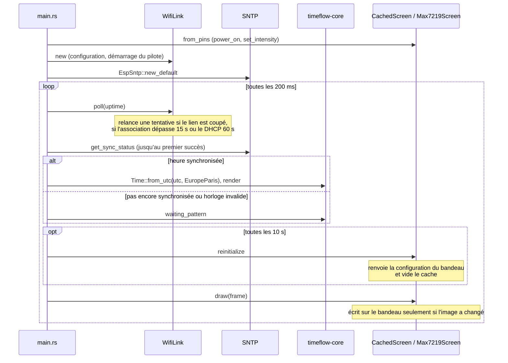
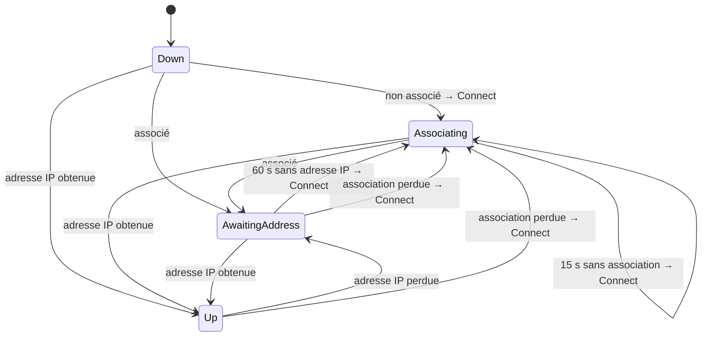

# Architecture

Le projet est un workspace Cargo de deux crates :

- **`timeflow-core`** : toute la logique indépendante du matériel. Il est
  `no_std` hors tests, ne dépend que de `log`, compile sur PC et contient les
  tests unitaires (`cargo test-core`).
- **`timeflow`** (racine) : le firmware ESP32. Il ne fait que brancher le
  matériel (GPIO, Wi-Fi, SNTP) sur les abstractions de `timeflow-core`.

## Composants

| Fichier                        | Rôle                                                                 |
|--------------------------------|----------------------------------------------------------------------|
| `timeflow-core/src/time.rs`    | `Time` (heure validée), trait `TimeZone` et fuseau `EuropeParis` (été / hiver). |
| `timeflow-core/src/frame.rs`   | Police 5x7, rendu de `HH:MM` et de l'attente `--:--` en image 32x8 (`Style`), découpage en modules 8x8 selon le montage (`ModuleLayout`, `Rotation`). |
| `timeflow-core/src/screen.rs`  | Trait `Screen` (afficher une image, renvoyer la configuration) et `CachedScreen` (n'envoie que les images qui changent). |
| `timeflow-core/src/timer.rs`   | `Interval` : minuterie périodique non bloquante.                     |
| `timeflow-core/src/link.rs`    | `Reconnector` : machine à états qui décide quand relancer la connexion réseau. |
| `timeflow-core/src/health.rs`  | `FailureLatch` : journalise une panne et son rétablissement, sans inonder les logs. |
| `src/main.rs`                  | Initialisation et boucle principale du firmware.                     |
| `src/display.rs`               | `Max7219Screen` : adaptateur du pilote `max7219` vers le trait `Screen`. |
| `src/wifi.rs`                  | `WifiLink` : connexion Wi-Fi non bloquante, pilotée par le `Reconnector`. |
| `build.rs`                     | Lit `wifi.toml` et injecte le SSID et le mot de passe à la compilation. |

## Dépendances entre composants

Les flèches vont de l'utilisateur vers ce qu'il utilise. Aucune flèche ne part
de `timeflow-core` vers le matériel, et `main.rs` ne connaît pas le pilote
`max7219` : seul `display.rs` l'utilise.

## Boucle principale

Tout se passe dans une seule boucle, rafraîchie toutes les 200 ms, sans appel
bloquant : l'affichage continue même pendant une coupure du Wi-Fi.

## Reconnexion Wi-Fi

`WifiLink` lit l'état du lien auprès du pilote (`LinkStatus`) : non associé
(`Down`), associé sans adresse IP (`Associated`) ou associé avec une adresse IP
(`Up`). Le `Reconnector` en déduit son état interne et l'action à mener.

Les deux étapes ont des délais séparés. Une station associée n'est jamais coupée
avant 60 s, car la déconnecter interrompt le DHCP, qui réessaie de lui-même tant
qu'elle reste associée. Avec un signal faible (-75 dBm environ), le DHCP a
déjà pris plus de 12 s sur la carte : avec un délai unique de 15 s, la connexion
était relancée cinq fois de suite et l'adresse IP n'arrivait qu'au bout de 80 s.

À chaque `Connect`, `WifiLink` déconnecte d'abord la station si elle est
encore associée, puis relance une connexion non bloquante.

## Coupure d'alimentation du bandeau

Le MAX7219 ne peut pas être relu : rien n'indique qu'il a perdu son
alimentation alors que l'ESP32 est resté allumé. Il redémarre alors éteint et
sans image. Toutes les 10 s, `main.rs` appelle donc `reinitialize` :
`Max7219Screen` renvoie tous les registres de configuration (mode test, lignes
actives, mode de décodage, luminosité, allumage) et `CachedScreen` vide son
cache, si bien que l'image courante est renvoyée dans le même tour de boucle.
Le bandeau se rallume ainsi en 10 s environ (plus un tour de boucle, soit
200 ms). Ce renvoi n'efface pas l'affichage : il ne provoque aucun clignotement
quand le bandeau n'a rien perdu.

Ce renvoi systématique couvre aussi un redémarrage imparfait : pendant la
coupure, le MAX7219 peut rester partiellement alimenté par ses entrées DIN, CS
et CLK, et ne pas repartir proprement.

## Gestion des erreurs

- Erreurs à l'initialisation (périphériques, bandeau, Wi-Fi, SNTP), toutes avant
  la boucle : `main` renvoie l'erreur et le firmware s'arrête, il n'y a rien à
  afficher sans elles.
- Erreurs dans la boucle (écriture et configuration du bandeau, horloge
  système, état du Wi-Fi) : elles sont journalisées une seule fois par
  `FailureLatch`, puis la boucle continue. Une image qui n'a pas pu être écrite
  est renvoyée au tour suivant.
