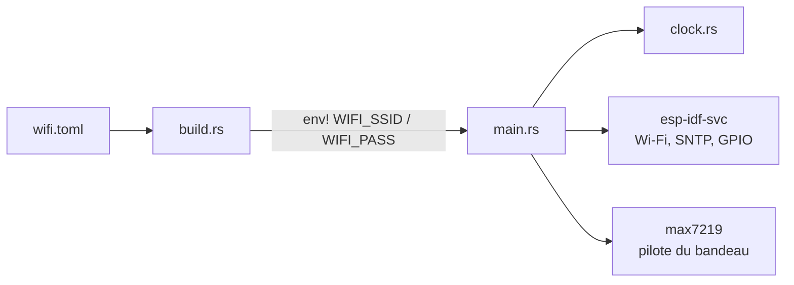
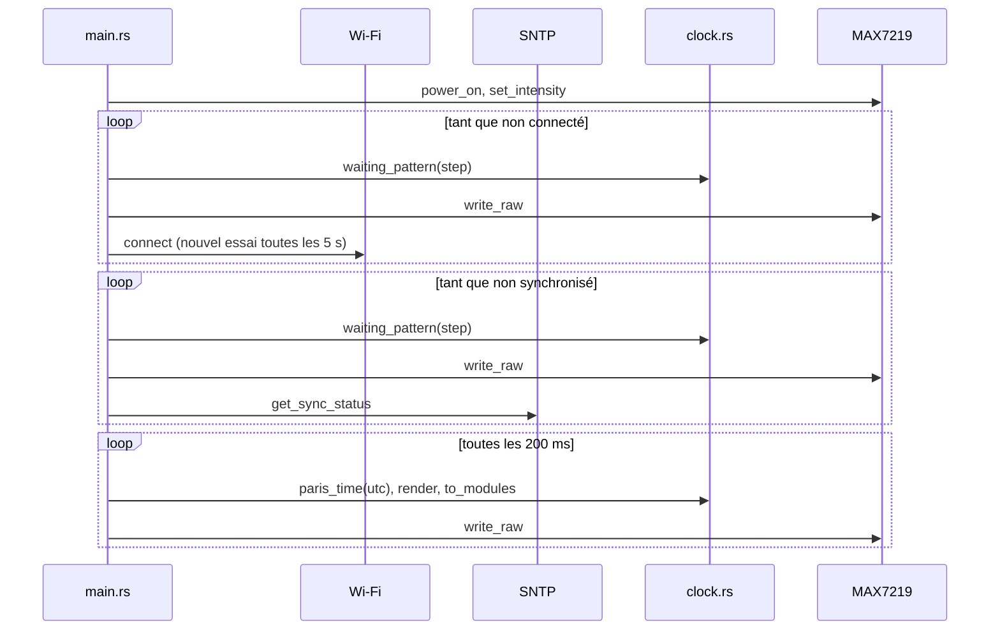

# Architecture

## Composants

| Fichier        | Rôle                                                                 |
|----------------|----------------------------------------------------------------------|
| `src/main.rs`  | Initialise le matériel, le Wi-Fi et le NTP, puis rafraîchit l'affichage. |
| `src/clock.rs` | Logique pure : police 5x7, heure de Paris (été / hiver), rendu d'une image 32x8, découpage en modules 8x8. |
| `build.rs`     | Lit `wifi.toml` et injecte le SSID et le mot de passe à la compilation. |

`clock.rs` ne dépend d'aucune bibliothèque matérielle : c'est ce qui permet de
le tester de façon isolée.

## Dépendances entre composants

## Démarrage

