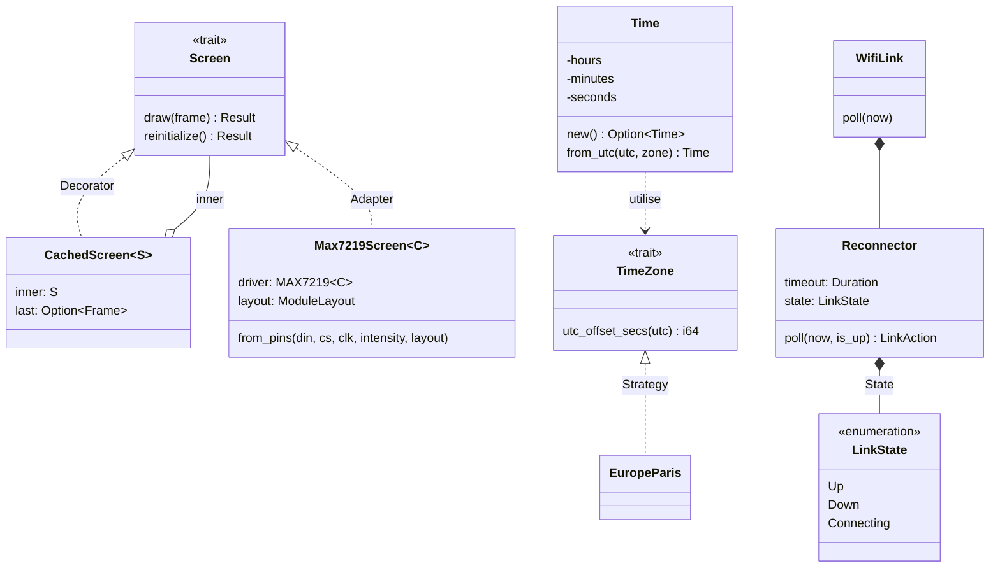

# Design patterns

Ce document recense les design patterns utilisés dans TimeFlow. Il doit être mis
à jour à chaque ajout, modification ou retrait d'un pattern (voir `CLAUDE.md`).

## Vue d'ensemble



## Patterns utilisés

### Newtype

- **Où** : `timeflow-core/src/time.rs`, type `Time`
- **Problème résolu** : `render` recevait trois `u8` sans contrôle. Une heure
  ou des minutes à 100 ou plus faisaient paniquer l'indexation de la police, et
  les valeurs de 24 à 99 donnaient un affichage absurde.
- **Pourquoi ce choix** : les champs sont privés et les seuls constructeurs
  (`Time::new`, qui valide, et `Time::from_utc`, qui produit toujours une heure
  valide) garantissent les bornes. Une heure invalide ne peut plus exister, et
  le rendu n'a plus besoin de vérifier.
- **Alternatives écartées** : valider dans `render` et renvoyer une erreur. Cela
  aurait reporté le problème sur chaque appelant.

L'`enum Rotation` de `frame.rs` suit la même idée : elle remplace un entier
« 0 à 3 » qui acceptait des valeurs sans signification.

### Strategy

- **Où** : `timeflow-core/src/time.rs`, trait `TimeZone`, implémenté par
  `EuropeParis`, et utilisé par `Time::from_utc`
- **Problème résolu** : la règle heure d'été / heure d'hiver était mêlée au
  calcul de l'heure du jour.
- **Pourquoi ce choix** : la règle de fuseau (quel décalage à quel instant) est
  séparée de la conversion (horodatage vers heures, minutes, secondes). Chacune
  se teste seule, et une autre règle (autre pays, décalage fixe, chaîne `TZ`)
  peut s'ajouter sans toucher au reste. Le trait est utilisé par généricité
  (`&impl TimeZone`) : il ne coûte rien à l'exécution.
- **Alternatives écartées** : un `enum` de fuseaux, qui aurait obligé à modifier
  le même `match` pour chaque nouveau fuseau.

### Adapter

- **Où** : `src/display.rs`, type `Max7219Screen`
- **Problème résolu** : la logique de l'horloge ne doit pas dépendre du pilote
  `max7219`. Ce pilote a ses propres types d'erreur, qui n'implémentent pas
  `std::error::Error`, et son propre adressage des modules.
- **Pourquoi ce choix** : `Max7219Screen::from_pins` crée et initialise le
  pilote, et `draw` traduit le trait `Screen` en appels au pilote (découpage de
  l'image en modules selon le `ModuleLayout`, conversion des erreurs). Le reste
  du code, `main.rs` compris, ne connaît que `Screen` : un autre afficheur
  pourrait le remplacer.
- **Alternatives écartées** : appeler le pilote directement depuis `main`, comme
  avant. Le couplage était fort et la conversion d'erreur était répétée à chaque
  appel.

### Decorator

- **Où** : `timeflow-core/src/screen.rs`, type `CachedScreen`
- **Problème résolu** : le bandeau était réécrit toutes les 200 ms, alors que
  l'image ne change qu'une fois par seconde, voire une fois par minute.
- **Pourquoi ce choix** : `CachedScreen` enveloppe n'importe quel `Screen` et
  n'envoie une image que si elle diffère de la dernière écrite avec succès,
  sans changer l'interface. Il transmet aussi `reinitialize` à l'afficheur
  enveloppé et vide alors son cache, car le contenu réel de l'afficheur n'est
  plus connu. L'adaptateur reste simple, et le cache est testé sur PC.
- **Alternatives écartées** : mémoriser la dernière image dans `main` ou dans
  `Max7219Screen`. Cela aurait mélangé deux responsabilités.

### State

- **Où** : `timeflow-core/src/link.rs`, type `Reconnector` (états `Up`, `Down`,
  `Connecting` de l'`enum LinkState`), utilisé par `WifiLink` dans `src/wifi.rs`
- **Forme** : la forme idiomatique en Rust, une `enum` d'états et un `match`,
  plutôt que des objets d'état polymorphes comme dans la version d'origine du
  pattern.
- **Problème résolu** : après la connexion initiale, une coupure du Wi-Fi
  n'était jamais rattrapée. De plus, une tentative restée à moitié faite
  (associée mais sans adresse IP) bloquait les essais suivants.
- **Pourquoi ce choix** : la décision (attendre ou relancer) dépend de l'état
  courant et du temps écoulé. La machine à états est pure, donc testée sur PC.
  `WifiLink` se contente d'exécuter l'action demandée, de façon non bloquante.
- **Diagramme** : voir « Reconnexion Wi-Fi » dans [architecture.md](architecture.md).
- **Alternatives écartées** : les appels de connexion bloquants de
  `BlockingWifi` (`connect`, `wait_netif_up`), qui figeaient l'affichage
  jusqu'à 15 s à chaque tentative. `BlockingWifi` reste utilisé pour le
  démarrage du pilote et la lecture de l'état du lien.

## Modèle de fiche

```markdown
### <Nom du pattern>

- **Où** : `<crate>/src/<fichier>.rs`, type ou fonction `<nom>`
- **Problème résolu** : ...
- **Pourquoi ce choix** : ...
- **Alternatives écartées** : ...

(diagramme Mermaid si utile)
```
